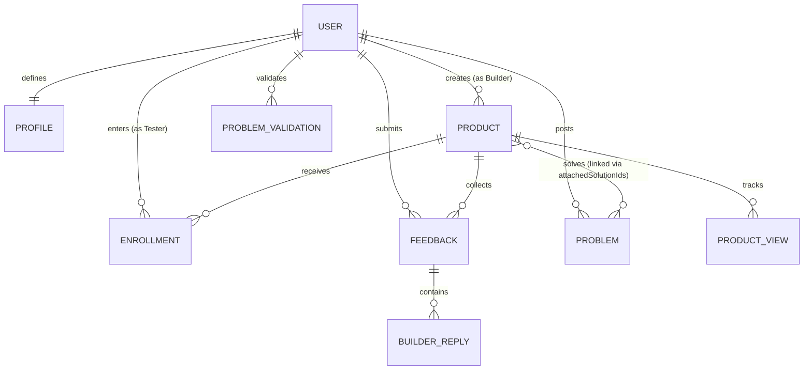

# BuildBoard — Full System Design Document (`system.md`)

This document provides the complete system architecture, domain modeling, component hierarchy, security threat model, and production migration blueprint for **BuildBoard**.

---

## Table of Contents
1. [Executive System Summary](#1-executive-system-summary)
2. [High-Level Architectural Architecture](#2-high-level-architectural-architecture)
3. [Domain Data Model & Schemas](#3-domain-data-model--schemas)
4. [Component Hierarchy & UI Topology](#4-component-hierarchy--ui-topology)
5. [Recommendation & Matching Algorithm Specification](#5-recommendation--matching-algorithm-specification)
6. [Security Architecture & Threat Model](#6-security-architecture--threat-model)
7. [Production Backend Migration Blueprint (MySQL + REST API)](#7-production-backend-migration-blueprint-mysql--rest-api)
8. [Performance & Scalability Characteristics](#8-performance--scalability-characteristics)

---

## 1. Executive System Summary

BuildBoard is a specialized peer-testing and product-critique network designed for indie hackers, early-stage founders, and technical beta testers. 

### Core System Philosophy
- **High-Signal Feedback over Upvotes**: The architecture rejects vanity counters and leaderboard algorithms in favor of a closed-loop testing protocol.
- **Explainable Matching**: Instead of non-deterministic AI agents, the platform employs deterministic tag and attribute vector matching with transparent scoring reasons.
- **Client-Side Prototype Isolation**: The current iteration functions as an autonomous, zero-dependency client application executing entirely inside the browser environment, persisting state to `Window.localStorage`.

---

## 2. High-Level Architectural Architecture

BuildBoard follows a **Modular Three-Tier Client Architecture**:

```
+---------------------------------------------------------------------------------------+
|                                    PRESENTATION LAYER                                 |
|                                                                                       |
|   React 19 (JSX)  •  React Router 8  •  Tailwind CSS v4 Engine  •  Motion Physics    |
|   - 14 Route Pages (/explore, /products/:id, /builder/dashboard, /problems, etc.)     |
|   - 12 Reusable Components (InteractiveBento, ShowcaseCarousel, ProductCard, etc.)    |
+---------------------------------------------------------------------------------------+
                                           │
                                           ▼
+---------------------------------------------------------------------------------------+
|                                  BUSINESS LOGIC LAYER                                 |
|                                                                                       |
|   Pure Utility Engines:                                                               |
|   - src/utils/recommendations.js (Deterministic Profile-to-Product Matching)         |
|   - src/utils/feedbackReminder.js (Time-Tiered Elapsed Reminder Engine)               |
|                                                                                       |
|   Scoped React Context Stores:                                                        |
|   - AuthContext: Identity, session lifecycle, role management                        |
|   - DemoDataContext: Products, enrollments, feedback, problem validations, views     |
|   - ThemeContext: Dark/light mode root class & CSS variable orchestration            |
+---------------------------------------------------------------------------------------+
                                           │
                                           ▼
+---------------------------------------------------------------------------------------+
|                                  PERSISTENCE LAYER                                    |
|                                                                                       |
|   Browser Storage (Zero-Latency Local Sandbox):                                       |
|   - 8 LocalStorage Namespaces (buildboard_demo_*)                                     |
|   - In-memory seed fallback (src/data/products.js, src/data/problems.js)              |
|   - Error-tolerant serialization with quota overflow boundaries                       |
+---------------------------------------------------------------------------------------+
```

---

## 3. Domain Data Model & Schemas

### Entity Relationship Diagram (ERD)



---

### Detailed Entity Schemas

#### 1. User & Profile Entity (`UserProfile`)
Stored under localStorage key: `buildboard_demo_profiles` (keyed by `normalizedEmail`).
```typescript
interface UserProfile {
  email: string;                  // Primary key (normalized lowercase)
  name: string;                   // User display name
  role: 'builder' | 'tester' | 'both';
  bio?: string;
  experienceLevel?: 'Beginner' | 'Intermediate' | 'Advanced' | 'Expert';
  targetRoles: string[];          // e.g. ["Frontend Developer", "Product Manager"]
  targetIndustries: string[];     // e.g. ["Developer Tools", "Fintech", "AI/ML"]
  targetTechnologies: string[];   // e.g. ["React", "Python", "Tailwind", "Docker"]
  interests: string[];            // General category tags
  createdAt: string;              // ISO 8601 Timestamp
  updatedAt: string;
}
```

#### 2. Product Entity (`Product`)
Stored under localStorage key: `buildboard_demo_custom_products` and merged with `src/data/products.js`.
```typescript
interface Product {
  id: string;                     // Unique identifier (e.g. "prod_1729123456789")
  name: string;                   // Product name
  tagline: string;                // Short 1-sentence value proposition
  description: string;            // Extended markdown product description
  creatorEmail: string;           // Foreign key -> UserProfile.email
  creatorName?: string;           // Cached display name
  categories: string[];           // Primary categories (e.g. ["DevTools", "Productivity"])
  audience: string;               // Target user description text
  targetRoles: string[];          // Ideal tester roles
  targetIndustries: string[];     // Applicable industries
  targetTechnologies: string[];   // Required or used tech stacks
  targetExperience?: string;      // Optional experience requirement
  feedbackRequest: string;        // Explicit question the builder wants answered
  whatToTry: string[];            // Ordered steps/tasks for tester to execute
  productUrl: string;             // External prototype URL (GATED)
  githubUrl?: string;             // Optional source repository URL
  enrollmentPaused: boolean;      // Gate control (true = blocks new testers)
  createdAt: string;              // ISO 8601 Timestamp
  updatedAt: string;              // Note: Pausing must NOT alter updatedAt
  gallery?: string[];             // URLs of product preview screenshots
}
```

#### 3. Enrollment Entity (`Enrollment`)
Stored under localStorage key: `buildboard_demo_enrollments`.
```typescript
interface Enrollment {
  id: string;                     // e.g. "enr_1729123456789"
  productId: string;              // Foreign key -> Product.id
  testerEmail: string;            // Foreign key -> UserProfile.email
  enrolledAt: string;             // ISO 8601 Timestamp (drives reminder engine)
}
```

#### 4. Feedback Entity (`Feedback`)
Stored under localStorage key: `buildboard_demo_feedback`.
```typescript
interface Feedback {
  id: string;                     // e.g. "fb_1729123456789"
  productId: string;              // Foreign key -> Product.id
  testerEmail: string;            // Foreign key -> UserProfile.email
  testerName: string;             // Display name at time of submission
  category: 'Bug' | 'UX / Usability' | 'Feature Request' | 'Performance' | 'General';
  workflow: string;               // Context: "What were you trying to do?"
  outcome: string;                // Critique: "What happened vs expected?"
  isHelpful: boolean;             // Builder toggle (drives Recognition score)
  createdAt: string;              // ISO 8601 Timestamp
  replies: BuilderReply[];        // Threaded replies
}

interface BuilderReply {
  id: string;
  authorEmail: string;
  authorName: string;
  text: string;                   // 3 - 1,000 characters
  createdAt: string;
}
```

#### 5. Problem Validation Entity (`Problem`)
Stored under localStorage key: `buildboard_demo_problems` and merged with `src/data/problems.js`.
```typescript
interface Problem {
  id: string;
  title: string;
  description: string;
  category: string;
  targetRoles: string[];
  targetIndustries: string[];
  authorEmail: string;
  authorName: string;
  validations: string[];          // Array of voter emails (like/upvote equivalent)
  attachedSolutionIds: string[];  // Array of Product.id solving this problem
  createdAt: string;
}
```

---

## 4. Component Hierarchy & UI Topology

```
<App>
 │
 ├── <SkipToContent />             # Screen-reader & keyboard skip navigation
 ├── <OpeningIntro />              # 400ms entrance branding animation
 ├── <Navbar>                      # Persistent top-level navigation
 │    ├── <Logo />
 │    ├── <ThemeToggle />          # Light/Dark switch
 │    └── <SettingsMenu />         # User profile menu & quick demo switchers
 │
 ├── <Suspense fallback={<PageFallback />}>
 │    └── <Routes>
 │         ├── <LandingPage>
 │         │    ├── HeroSection (Kinetic headline + 3D Tilt Preview)
 │         │    ├── <InteractiveBentoShowcase /> (4-card live interactive preview)
 │         │    ├── <ShowcaseCarousel /> (Spotlight rotating cards)
 │         │    └── HowItWorksSection (Connecting line animation)
 │         │
 │         ├── <ExplorePage>
 │         │    ├── SearchBar & CategoryFilters
 │         │    ├── RecommendationsRail (High-match products)
 │         │    └── ProductGrid -> <ProductCard />[]
 │         │
 │         ├── <ProductDetailsPage>
 │         │    ├── ProductHero & Tagline
 │         │    ├── EnrollmentGate (Unlocks URL & Test Checklist)
 │         │    ├── WhatToTryList
 │         │    ├── FeedbackSubmissionForm
 │         │    └── FeedbackThreadFeed -> <FeedbackItem />[]
 │         │
 │         ├── <SubmitProductPage> (Multi-step listing builder)
 │         ├── <BuilderDashboardPage> (Metrics: Views, Enrolled, Feedback)
 │         ├── <TesterActivityPage> (Active enrollments, Reminders, Recognition)
 │         ├── <ProfileSetupPage> (Role, Industry, Tech tag selectors)
 │         ├── <ProblemsPage> / <SubmitProblemPage> / <ProblemDetailsPage>
 │         └── <SignInPage> / <SignUpPage> / <NotFoundPage>
 │
 └── <Footer />
```

---

## 5. Recommendation & Matching Algorithm Specification

Implemented in `src/utils/recommendations.js`.

### Mathematical Scoring Function
For a given product $P$ and user profile $U$:

$$\text{Score}(P, U) = 3 \cdot |P_{\text{categories}} \cap U_{\text{interests}}| + 3 \cdot |P_{\text{roles}} \cap U_{\text{roles}}| + 2 \cdot |P_{\text{tech}} \cap U_{\text{tech}}| + 2 \cdot |P_{\text{industries}} \cap U_{\text{industries}}| + E(P, U)$$

Where experience match $E(P, U)$:
$$E(P, U) = \begin{cases} 
1 & \text{if } P_{\text{targetExperience}} \neq \text{null and } P_{\text{targetExperience}} = U_{\text{experienceLevel}} \\
0 & \text{otherwise}
\end{cases}$$

### Match Quality Classification
- **High Match**: $\text{Score} \ge 6$ (rendered with terracotta badge and detailed reasons).
- **Moderate Match**: $3 \le \text{Score} < 6$.
- **Low / Unmatched**: $\text{Score} < 3$.

---

## 6. Security Architecture & Threat Model

### Current Client-Side Prototype Constraints
1. **Client-Visible Secrets**: In the demo prototype, external prototype URLs exist inside client-side JS memory even before enrollment.
2. **Client-Side Auth**: The demo user identity is stored in `localStorage` and can be edited via DevTools.
3. **Derived Recognition**: Tamperable in local storage, but deterministic across reloads.

### Production Security Model (Mandatory for Cloud Launch)
```
                                CLIENT UNTRUSTED BOUNDARY
─────────────────────────────────────────────────────────────────────────────────────────
                                SERVER TRUSTED BOUNDARY

[Client Browser] 
       │
       ├─► 1. HTTPS / TLS 1.3 Termination (HSTS, CSP, CORS headers)
       │
       ├─► 2. Reverse Proxy & Rate Limiter (Cloudflare / NGINX / Envoy)
       │     └─► 100 req/min for public catalog; 10 req/min for feedback submits
       │
       ├─► 3. Authentication Gateway (JWT with HttpOnly SameSite=Strict cookies)
       │     └─► OAuth2 (GitHub / Google) + Argon2id hashed passwords
       │
       ├─► 4. Application Server (Node.js Express / Go / Fastify)
       │     ├─► Schema Validation via Zod / TypeBox (Strict input sanitization)
       │     ├─► Server-Enforced Enrollment Gate:
       │     │     CRITICAL: 'productUrl' is ONLY included in JSON payload if:
       │     │     EXISTS(SELECT 1 FROM enrollments WHERE user_id = req.user.id)
       │     └─► HTML Sanitization: DOMPurify on feedback markdown
       │
       └─► 5. Database Layer (MySQL 8.0+ with connection pooling)
             └─► Row-Level Ownership Verification (Builders can only reply to own products)
```

---

## 7. Production Backend Migration Blueprint (MySQL + REST API)

### MySQL Relational Database Schema DDL

```sql
-- 1. Users Table
CREATE TABLE users (
    id VARCHAR(36) PRIMARY KEY,
    email VARCHAR(255) NOT NULL UNIQUE,
    password_hash VARCHAR(255) NULL,
    name VARCHAR(100) NOT NULL,
    role ENUM('builder', 'tester', 'both') DEFAULT 'both',
    bio TEXT,
    experience_level ENUM('Beginner', 'Intermediate', 'Advanced', 'Expert'),
    created_at TIMESTAMP DEFAULT CURRENT_TIMESTAMP,
    updated_at TIMESTAMP DEFAULT CURRENT_TIMESTAMP ON UPDATE CURRENT_TIMESTAMP
);

-- 2. User Profiles Targeting Tags
CREATE TABLE user_target_tags (
    id BIGINT AUTO_INCREMENT PRIMARY KEY,
    user_id VARCHAR(36) NOT NULL,
    tag_type ENUM('role', 'industry', 'technology', 'interest') NOT NULL,
    tag_value VARCHAR(100) NOT NULL,
    FOREIGN KEY (user_id) REFERENCES users(id) ON DELETE CASCADE,
    UNIQUE KEY uq_user_tag (user_id, tag_type, tag_value)
);

-- 3. Products Table
CREATE TABLE products (
    id VARCHAR(36) PRIMARY KEY,
    creator_id VARCHAR(36) NOT NULL,
    name VARCHAR(150) NOT NULL,
    tagline VARCHAR(255) NOT NULL,
    description TEXT NOT NULL,
    audience TEXT,
    target_experience VARCHAR(50),
    feedback_request TEXT NOT NULL,
    product_url VARCHAR(500) NOT NULL,
    github_url VARCHAR(500),
    enrollment_paused BOOLEAN DEFAULT FALSE,
    created_at TIMESTAMP DEFAULT CURRENT_TIMESTAMP,
    updated_at TIMESTAMP DEFAULT CURRENT_TIMESTAMP,
    FOREIGN KEY (creator_id) REFERENCES users(id) ON DELETE RESTRICT
);

-- 4. Product Target Criteria
CREATE TABLE product_target_criteria (
    id BIGINT AUTO_INCREMENT PRIMARY KEY,
    product_id VARCHAR(36) NOT NULL,
    criteria_type ENUM('category', 'role', 'industry', 'technology') NOT NULL,
    criteria_value VARCHAR(100) NOT NULL,
    FOREIGN KEY (product_id) REFERENCES products(id) ON DELETE CASCADE,
    INDEX idx_product_criteria (criteria_type, criteria_value)
);

-- 5. Product Test Steps ("What to Try")
CREATE TABLE product_test_steps (
    id BIGINT AUTO_INCREMENT PRIMARY KEY,
    product_id VARCHAR(36) NOT NULL,
    step_order INT NOT NULL,
    instruction TEXT NOT NULL,
    FOREIGN KEY (product_id) REFERENCES products(id) ON DELETE CASCADE
);

-- 6. Enrollments Table (Unique constraint prevents double enrollments)
CREATE TABLE enrollments (
    id VARCHAR(36) PRIMARY KEY,
    product_id VARCHAR(36) NOT NULL,
    tester_id VARCHAR(36) NOT NULL,
    enrolled_at TIMESTAMP DEFAULT CURRENT_TIMESTAMP,
    FOREIGN KEY (product_id) REFERENCES products(id) ON DELETE CASCADE,
    FOREIGN KEY (tester_id) REFERENCES users(id) ON DELETE CASCADE,
    UNIQUE KEY uq_tester_product (tester_id, product_id)
);

-- 7. Feedback Submissions
CREATE TABLE feedback (
    id VARCHAR(36) PRIMARY KEY,
    product_id VARCHAR(36) NOT NULL,
    tester_id VARCHAR(36) NOT NULL,
    category ENUM('Bug', 'UX / Usability', 'Feature Request', 'Performance', 'General') NOT NULL,
    workflow TEXT NOT NULL,
    outcome TEXT NOT NULL,
    is_helpful BOOLEAN DEFAULT FALSE,
    created_at TIMESTAMP DEFAULT CURRENT_TIMESTAMP,
    FOREIGN KEY (product_id) REFERENCES products(id) ON DELETE CASCADE,
    FOREIGN KEY (tester_id) REFERENCES users(id) ON DELETE CASCADE
);

-- 8. Builder Feedback Replies
CREATE TABLE feedback_replies (
    id VARCHAR(36) PRIMARY KEY,
    feedback_id VARCHAR(36) NOT NULL,
    author_id VARCHAR(36) NOT NULL,
    reply_text TEXT NOT NULL,
    created_at TIMESTAMP DEFAULT CURRENT_TIMESTAMP,
    FOREIGN KEY (feedback_id) REFERENCES feedback(id) ON DELETE CASCADE,
    FOREIGN KEY (author_id) REFERENCES users(id) ON DELETE CASCADE
);

-- 9. Product Views Counter
CREATE TABLE product_views (
    product_id VARCHAR(36) PRIMARY KEY,
    view_count BIGINT DEFAULT 0,
    last_viewed_at TIMESTAMP DEFAULT CURRENT_TIMESTAMP ON UPDATE CURRENT_TIMESTAMP,
    FOREIGN KEY (product_id) REFERENCES products(id) ON DELETE CASCADE
);
```

---

### REST API Endpoint Specification

| Method | Endpoint | Access | Description |
| :--- | :--- | :--- | :--- |
| `POST` | `/api/v1/auth/sign-in` | Public | Authenticates credentials, returns secure cookie |
| `POST` | `/api/v1/auth/sign-up` | Public | Registers user profile |
| `GET` | `/api/v1/products` | Public | Returns product catalog (without `product_url`) |
| `GET` | `/api/v1/products/:id` | Public | Returns product details (masks `product_url` if not enrolled) |
| `POST` | `/api/v1/products` | Builder | Creates new product listing |
| `PATCH` | `/api/v1/products/:id/pause` | Owner | Toggles enrollment pause state |
| `POST` | `/api/v1/products/:id/enroll` | Tester | Enrolls tester and reveals `product_url` |
| `POST` | `/api/v1/products/:id/feedback`| Enrolled | Submits structured feedback |
| `POST` | `/api/v1/feedback/:id/reply` | Owner | Adds builder response to feedback |
| `PATCH` | `/api/v1/feedback/:id/helpful`| Owner | Toggles helpful mark (updates recognition) |
| `GET` | `/api/v1/tester/activity` | Tester | Retrieves enrollments, reminders, and feedback history |
| `GET` | `/api/v1/builder/dashboard` | Builder | Returns aggregate metrics (views, conversion rate) |

---

## 8. Performance & Scalability Characteristics

1. **Client Bundle Optimization**:
   - Dynamic route splitting (`React.lazy`) divides the application into lightweight page chunks loaded on-demand.
   - Initial load payload is restricted to core layout components (`Navbar`, `Footer`, `AuthContext`), maintaining fast Largest Contentful Paint (LCP) times.
2. **Deterministic Recommendation Speed**:
   - `computeProductMatch` operates in $O(N \cdot M)$ time where $N$ is product count and $M$ is tag count ($<15$ tags).
   - Entire catalog recommendation sorting runs in $< 2\text{ms}$ on standard hardware.
3. **Database Performance Target (Post-Migration)**:
   - Composite index on `(criteria_type, criteria_value)` allows fast tag-intersection queries using relational `JOIN` operations.
   - Product view tracking can be buffered in a Redis counter (`INCR product:views:<id>`) and flushed to MySQL periodically via background job to avoid database write contention.
